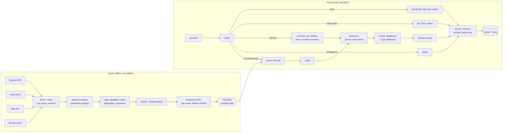

# On the Record

**Verified, cited answers from the UK Parliament's official record.**

On the Record answers plain-English questions about what was said and decided in Parliament, using Hansard (the
official report) and Parliament's own data on votes, bills and members. Its one rule: **a reader only ever sees a
claim that has been checked against the record, attributed to the member who made it, and dated.** When the record
does not hold the answer, it says so rather than guessing. When a question gets the facts wrong, it corrects them.

```text
Q: Why did NATS blame a cyber-attack for the September flight disruption?

A: Keir Mather said the disruption was caused by a technical issue in NATS's Swanwick flight processing system,
   which affected the processing of flight plans used by data controllers. [2026-09-10]
   Keir Mather said NATS advised that the problem was affecting the flight processing system and the data being fed
   into controller radar displays. [2026-09-10]
   Keir Mather said a cyber-attack had now been ruled out in relation to the incident. [2026-09-10]
   ...
```

```text
Q: On 9 September 2026, was the motion on Financial Services and Markets Bill [HL] carried in the Lords?

A: The Lords divided 5 times on 9 September 2026 on business matching this description, and the motion was agreed
   to each time (248 to 163, 226 to 162, 194 to 138, 196 to 138, 188 to 125).
```

The first answer corrects a false premise from verified, attributed statements; the second is an exact fact read
from the division records with SQL. No language model wrote the second answer at all. Both are real outputs from
the development evaluation (`reports/e3_eval_dev_s18_final_judged.json`).

---

## Contents

1. [Why this exists](#why-this-exists)
2. [Design principles](#design-principles)
3. [Architecture](#architecture)
4. [The data](#the-data)
5. [How it is evaluated](#how-it-is-evaluated)
6. [Results](#results)
7. [The journey so far](#the-journey-so-far)
8. [What is next](#what-is-next)
9. [Running it](#running-it)
10. [Repository layout](#repository-layout)
11. [Limitations](#limitations)
12. [Licences and attribution](#licences-and-attribution)

---

## Why this exists

Hansard is public, but it is hard to use. It runs to millions of words a year, it is shaped by parliamentary
procedure, and the people in it change their names, titles, parties and offices over time. A journalist checking a
quote, a student researching a bill, or a voter wondering whether "the government scrapped the two-child cap" needs
more than a search box. They need **an answer they can trust and check**.

Generic chatbots are the wrong tool here. Ask one what a minister said and it will often produce something a
minister *might* have said. In a parliamentary context that is the worst possible failure: words put in a real
person's mouth. So this project is built around the opposite instinct. Every sentence a reader sees is traceable to
a passage in the record, attributed by a database lookup rather than by a model, and verified before display.

The goal is a system that is genuinely useful to an everyday reader, **measurably** trustworthy, cheap enough to run
in public, and built to cover **ten years of Parliament (2015 onwards)**.

## Design principles

- **The truth contract.** Only verified claims are rendered. The language model proposes atomic, cited claims; an
  entailment model checks each claim against its cited passage; speaker and date are checked in SQL, never by a
  model. A claim that fails is dropped, never softened.
- **Deterministic wherever possible.** Votes, division results, bill stages, who held an office on a date, who spoke
  in a debate: these are facts in Parliament's own data. They are answered by SQL, exactly, with no language model
  involved.
- **Honest abstention, not cowardice.** Declining when the record lacks the answer is right. Declining when the answer
  was retrieved and sitting in front of the model is a failure, and it is measured as one (the "cowardice rate").
- **Correct the premise.** "Why did the Lords throw out the bill?" should get "the record shows the Lords debating
  amendments, not rejecting it", not an answer to the question as asked.
- **Measure everything, and measure honestly.**
  - Pre-registered quality bars.
  - A sealed exam split nobody looks at until the end.
  - Structurally blind grading.
  - A judge from a different model family than the generator, calibrated against human labels.
  - Intervals, not point estimates.
  - A summary line that cannot confuse "nothing was measured" with "nothing was wrong".
- **Built for the ten-year corpus, not the slice in hand.** Rules derived from how Parliament works, then checked
  against the data, rather than inferred from whatever the current data happens to contain.

## Architecture



**Ingestion** (`src/ingest/`, `scripts/pipeline.py`).
- Raw API responses are fetched into a local, hash-manifested cache, so the loader never touches the network and
  any corpus can be rebuilt byte for byte.
- Each window is loaded with quarantine ceilings: a window that loses more than stray records fails the run rather
  than loading quietly.
- Speaker labels are parsed into the name as printed at the time, the role (member, minister, Speaker, Deputy
  Speaker, chair and so on), the office at that date, the party and the constituency.
- Procedural boilerplate is flagged. Divisions keep their tellers, proxy votes and English Votes for English Laws
  double-majority counts. Bills are linked to stages and sittings; corrections are linked to the speeches they
  correct.
- A 78-check invariant gate (68 hard checks) must pass after every load.

**Retrieval** (`src/retrieval/`; frozen after a measured bake-off, with changes only through a logged amendment).
- Three legs fused by reciprocal rank: dense HNSW search over `bge-small-en-v1.5` embeddings, a BM25-style keyword
  search in SQL with an IDF floor, and a speaker leg.
- Then a `bge-reranker-base` cross-encoder blend, near-duplicate collapse, and neighbour expansion.
- Each sentence is embedded under a header carrying its date, House, debate heading, speaker and party, which
  measurably helps "who said…" questions.
- The index is stored as **half-precision vectors**: 43% smaller, with no loss of recall on development questions.

**The truth layer** (`src/answer/facts.py`, `roster.py`, `graph.py`, `contract.py`).
- A SQL fact engine for division tallies, results and individual votes, bill stage dates and offices held on a date.
- Roster tools for who spoke, in order.
- A typed answer contract shared by every route.
- Graph tools all answer in under 25 ms at p95.

**The brain** (`src/answer/pipeline.py`, `routes.py`, `generate.py`, `verify.py`).
- A router sends each question to a route.
- The retrieval route builds a deck of cards (passages with their headers) and asks the generator (DeepSeek, with
  reasoning off) for atomic, cited claims.
- A MiniCheck entailment model running on a local GPU service (`gpu/`) verifies each claim against its passage.
- A relevance gate checks that the verified claims actually address the question.
- The overview route answers each debate separately, verifies those answers, then writes a summary that may contain
  only what the verified per-debate claims support.

**Operations.**
- Answers are cached under a key that includes the corpus version, retrieval configuration, embedding recipe, prompt,
  model and code version, so a code change can never serve a stale answer.
- Every request writes a trace row (47 columns), so any failure can be located to the layer that caused it.
- Spend is guarded per run, and a failed request is recorded as a failure, never graded as an answer.

## The data

- **Sources:** Hansard (both Houses), the Commons and Lords Votes APIs, the Bills API and the Members API, all under
  the [Open Parliament Licence](https://www.parliament.uk/site-information/copyright-parliament/open-parliament-licence/).
- **Today:** 1,437,856 chunks across several corpus windows. They hold about a year of sittings between 2020 and
  2026, plus a sealed exam window.
- **The ten-year plan:** the pipeline, the schema and the index are sized for 45 quarter-bounded windows from 2015:
  about 12.2 million vectors, with a preflight that measured about 84–100 GB of disk. That load is the next big
  milestone.
- **The plan is shaped by what changes over a decade:**
  - members who move to the Lords are named as they were printed at the time;
  - English Votes for English Laws (2015–21) double majorities are stored, not lost;
  - a whole window with no Votes API coverage is recorded as a known source gap, not reported as "no such
    division".

## How it is evaluated

**The gold set** (`tests/data/gold_v2.json`).
- 488 questions across about 30 categories, from plain named-speaker questions to adversarial ones (false premises,
  loaded framing, misattribution, negation flips, out-of-window dates, boilerplate traps).
- 161 are marked critical.
- Split into dev (223) and test (199); a burned historical slice (W3, 66) is kept as an out-of-era check.
- A separate sealed **exam (W5, 176 questions over its own corpus window)** is held back for the final evaluation and
  is not part of this repository.

**Seven outcomes, one rubric** (`src/goldset/rubric.py`): correct; correct but missing an optional point; missing a
vital point; correct abstention; over-abstention; wrong but benign; harmful. One rubric module generates the judge's
prompt, the human calibration page and the grading code, and a test fails if any two disagree.

**Judging.**
- Exact facts are graded deterministically.
- Free-text answers are graded by an LLM judge from a **different model family** (Gemini) than the generator
  (DeepSeek), through a **blind packet**: opaque ids, a shuffled order, a separate key, and a strict import that
  refuses malformed or mismatched replies (`scripts/gemini_judge.py`).

**Calibration against a human** (`src/goldset/triage.py`).
- The judge's most contested verdicts were adjudicated by a person on 20 cards, each graded blind before the judge's
  verdict was revealed.
- The strata were fixed before labelling, and κ was design-weighted back to the run.

**Gates.**
- `scripts/e3_gate_report.py` reports every bar with bounded verdicts: PASS only in the worst case, and NOT
  EVALUATED when a bar could not be measured.
- The database has its own 78-check invariant gate.
- The test split is run **once**, as a confirmation, never as a tuning target.

**Engineering quality.**
- 3,785 automated tests.
- Mutation testing (`tools/mutation/`): deliberate bugs are injected into copies of the source, and each must be
  caught (the reader-text suite catches 81 of 81).
- CI with lint and a secret scan.

## Results

**Retrieval** (237 retrieval-testable questions, binary relevance; `reports/session3_final.json`):

| Split | R@final | R@10 | MRR@10 | nDCG@10 | Ceiling@100 |
|---|---|---|---|---|---|
| dev | 0.638 | 0.568 | 0.495 | 0.456 | 0.744 |
| test | 0.526 | 0.472 | 0.455 | 0.402 | 0.652 |

**The truth layer:** structured facts are 100% exact on dev and 93 of 95 on test. The verifier at bf16 agrees with
fp32 on 300 of 300 pairs.

**Answers: the pre-registered bars on dev, and the one-shot test confirmation**
(`reports/e3_eval_dev_s18_final_judged.json`, `reports/triage_result.json`, `reports/e3_eval_test_judged.json`):

| Bar | Target | Dev (223, adjudicated) | Test (199, confirmation) |
|---|---|---|---|
| Harmful answers | 0 | **0** | 1 |
| Over-abstention | ≤ 15% | **11.7%** | 18.1% |
| Vital-point coverage | ≥ 80% | **88.4%** | **81.9%** |
| Correct abstention | ≥ 90% | **20 / 20** | 9 / 11 |
| Router accuracy | ≥ 90% | **100 / 100** | 92 / 95 |
| Answer latency, p95 | < 12 s | **5.7 s** | **6.0 s** |
| Answers made without the verifier | 0 | **0** | **0** |

**Calibration and cost.**
- The LLM judge agrees with the human on outcome categories with **Cohen's κ = 0.75** (design-weighted; 95%
  interval 0.41–0.86).
- A full 199-question evaluation run costs **$0.11** in generation, about **$0.0005 an answer**.

**Reading the test column honestly.** The system passed every bar on dev, then missed four on the held-out test.
That gap is the most useful result in this repository. Every miss was traced to a root cause, and each cause was
measured across the whole corpus to separate a real class of defect from an unlucky question. Three examples:
- **The one harmful answer** named the Deputy Speaker as a debate's opener: her "I call the Chair of the Committee"
  is the first speech by sequence. That pattern turns out to affect about 11% of debates, so it is a class, not an
  edge case.
- **Divisions.** Most over-abstentions came from questions that match several divisions on one day. That is true of
  79% of divisions, so the answer should list each result rather than ask which one was meant.
- **Out-of-window dates.** Two questions about 2012 and 2018 were answered from later retrospective speeches without
  saying the record does not cover those years.

These drive the next version (below). The test split is never used to tune; fixes are justified from how Parliament
works and proven on fresh questions.

## The journey so far

1. **Ingest and structure** (Phases 0–2).
   - A first 13-day corpus, then Corpus v2: windows across 2020–2026.
   - A schema hardened with foreign keys, CHECK constraints and an invariant gate.
   - Speaker parsing that survives Hansard's many label formats.
   - Bills, divisions and members linked into one graph.
2. **Retrieval** (E1).
   - An embedding bake-off, a hybrid retriever, reranking, and query-time date filters.
   - A 488-question gold set built and triple-graded; the relevance judge was checked against human labels
     (binary κ 0.69).
   - Retrieval frozen; a sealed exam window and its questions built and audited.
3. **The truth layer** (E2): the SQL fact engine, the answer contract, roster and graph tools, and a GPU entailment
   verifier proved equivalent at half precision.
4. **The brain** (E3).
   - Routing, generation, verification, overviews, caching and tracing.
   - Over-abstention on dev cut from 66% in the first full run to under 12%, with zero harmful answers.
   - A cross-family judge with blind packets and human calibration.
5. **A foundation audit.** Before scaling to ten years: the data layer re-checked end to end.
   - The default database made safe.
   - Members' names as printed at the time.
   - EVEL counts recovered.
   - Source gaps recorded.
   - The ten-year plan corrected to start in 2015.
   - The vector index converted to half precision.
6. **The test confirmation, and its post-mortem** (above).

A few lessons this project paid for, and now builds in:
- **The cheapest test first.** A one-item run once caught a misconfigured API key whose failures the evaluation
  would otherwise have graded as refusals.
- **Read the output, not the pass mark.** Reading the answers themselves showed that every overview was reaching
  readers as empty text, which no count had revealed.
- **A summary must separate "nothing was measured" from "nothing was wrong".** A run once printed `HARMFUL 0` after
  every retrieval had failed.
- **"Noted, not started" is how you lose.** The test's one harmful answer came from a defect already written down.
- **Before calling a defect an edge case, measure how often it happens.**

## What is next

The next version is planned around one finding: **the system understood a question only through templates and the
categories of its own test set.** Real users will ask anything. The plan:

- **A question-understanding layer.** Every question becomes a typed, database-validated frame that every route
  consumes:
  - the intent;
  - the members, bills, divisions and debates it names, linked to the database;
  - its dates, resolved against the corpus windows;
  - what it presupposes;
  - its parts;
  - the kind of answer it expects.

  Unfamiliar questions get a useful fallback, never a bare refusal.
- **Role-aware chronology and event coreference.** Presiding officers are never "openers". Several matching divisions
  are answered with every result. Records of one debate split across sittings are treated as one debate.
- **Corrections instead of refusals.** "X is not recorded saying that; on that subject the record has Y saying…".
- **Temporal scope.** A question about a period outside the record is told so first, with any later references
  clearly marked as later.
- **Answers an everyday reader can use.** A short brief built from verified structured facts (what the bill is, where
  it came from, where it stands), "both sides" answers organised by side only where the stance is grounded in the
  record, and a plain statement of anything the record does not show.
- **Measured without cheating.** A fresh validation set written from the record; behavioural (metamorphic) tests
  generated from the database, which need no labels; an open-world suite of odd, off-topic and hostile questions.
  The sealed exam is used once, at the end.
- **The ten-year corpus, and a public deployment** on a budget of about £10 a month.

## Running it

**Requirements:** Python 3.12 with [uv](https://docs.astral.sh/uv/), and Docker. A CUDA GPU is optional; it is used
for embedding, reranking and verification by the separate `gpu/` service. A DeepSeek API key is needed to generate
free-text answers.

```powershell
Copy-Item .env.example .env     # the defaults match docker-compose.yml
docker compose up -d            # Postgres 16 + pgvector 0.8.6, published on 127.0.0.1:5432 only
uv sync
uv run python -m app.migrate    # the schema; idempotent
uv run pytest                   # tests that need loaded data skip on an empty database
```

**Build a corpus** (fetch, load, rules, chunk, embed, gates; resumable, and safe to re-run):

```powershell
uv run python scripts/pipeline.py run session1 --dry-run   # preflight and the plan; changes nothing
uv run python scripts/pipeline.py run session1             # the full build, unattended
uv run python scripts/pipeline.py status session1
cd gpu; uv run python api.py                               # the GPU service on 127.0.0.1:8001 (embed, rerank, verify)
uv run python scripts/audit_invariants.py --gate           # 78 checks; exits 1 on any hard failure
```

**Ask and evaluate.** There is no public serving endpoint yet (a FastAPI `/ask` service is a planned milestone).
Today, answers are produced through the evaluation harness, which runs the full production path:

```powershell
uv run python scripts/eval_answers.py --dry-run                           # price a run; spends nothing
uv run python scripts/eval_answers.py --split dev --ids db0001,hum0046 --label demo   # a few questions
uv run python scripts/eval_answers.py --split dev --no-judge              # the whole dev split, judge-free
uv run python scripts/gemini_judge.py export --report reports/<run>.json  # the blind packet for the judge
uv run python scripts/e3_gate_report.py reports/<run>_judged.json         # every bar, one table
```

**Quality checks:**

```powershell
uv run pytest -q                                   # 3,785 tests
uvx ruff check src scripts tests gpu tools         # lint
uv run python tools/mutation/run.py --suite reader # mutation testing, one suite at a time
uv run python scripts/check_secrets.py             # credentials in tracked files
```

## Repository layout

```text
src/
  app/         configuration, database access, migrations, and the guard that keeps tools off the wrong database
  ingest/      fetching, loading, speaker parsing, rules, chunking, members, divisions, bills
  retrieval/   hybrid search, reranking, lexicon, the frozen configuration and its amendment trail
  answer/      router, routes, cards, generation, verification, the answer contract, cache and trace
  goldset/     the gold set's schema, the rubric, judges, calibration and the blind-packet machinery
scripts/       command-line entry points: the pipeline, evaluation, judging, gates and measurements
gpu/           the GPU service (embedder, reranker, entailment verifier) as a separate uv project, with its own tests
db/            the baseline schema and every migration
config/        corpus window plans and the frozen retrieval configuration (hashed)
tests/         the test suite, fixtures and the gold set (dev and test splits)
tools/         mutation testing, and the templates for the human review pages
reports/       results: the retrieval scorecard, the evaluation runs, the judge packets and verdicts, calibration
logs/          the judging prompt given to the offline judge (generated from the rubric; a test holds it to the code)
```

## Limitations

- **The harmful rate cannot yet be claimed below 1%.** Zero harmful answers on dev's 71 critical questions bounds
  the true rate at about 4% (a 95% upper bound). Tighter claims need several hundred more critical trials, which is
  part of the next version's evaluation plan.
- **The corpus is about a year of sittings today.** It is built for ten years, but that load has not run yet, so
  latency and recall at that scale are projected, not measured.
- **The judge is a single LLM family, calibrated on a small, deliberately contested sample.** The interval on κ is
  wide, and it is reported.
- **There is no public deployment yet.**

## Licences and attribution

- **Parliamentary data:** contains Parliamentary information licensed under the
  [Open Parliament Licence v3.0](https://www.parliament.uk/site-information/copyright-parliament/open-parliament-licence/).
- **Models:** `BAAI/bge-small-en-v1.5`, `BAAI/bge-reranker-base` and a MiniCheck entailment model are used under
  their own licences. Answers are generated by DeepSeek; evaluation verdicts come from Google's Gemini.
- **Code:** no licence has been chosen yet; until one is added, all rights are reserved.
